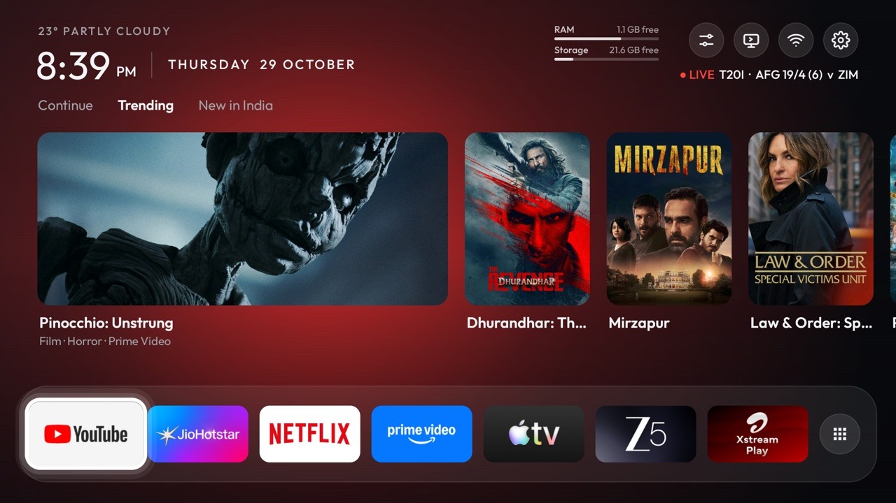
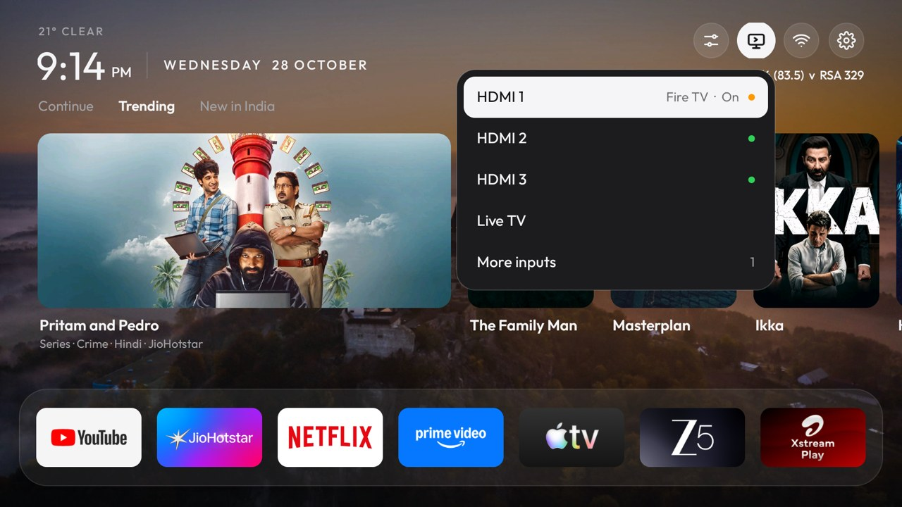
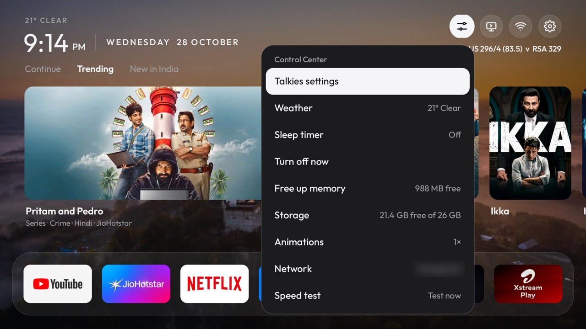
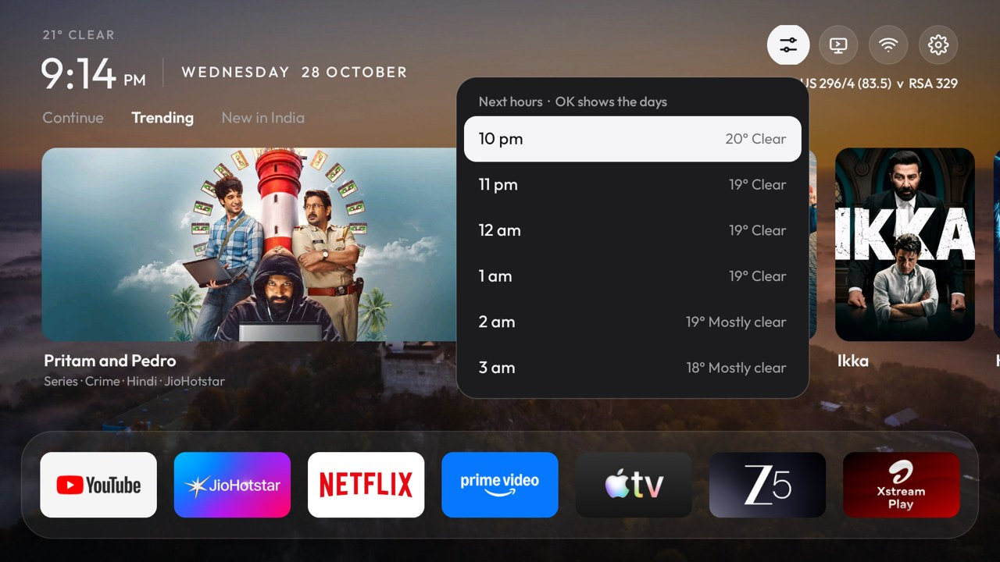
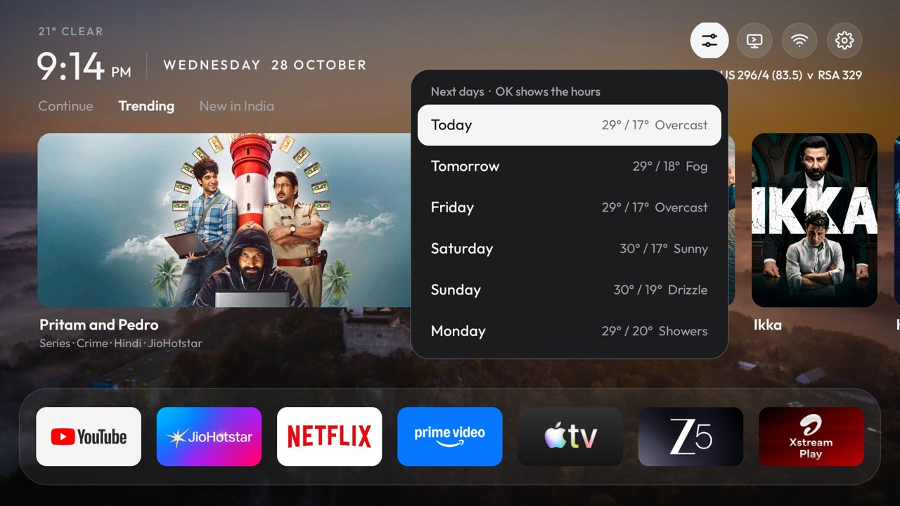
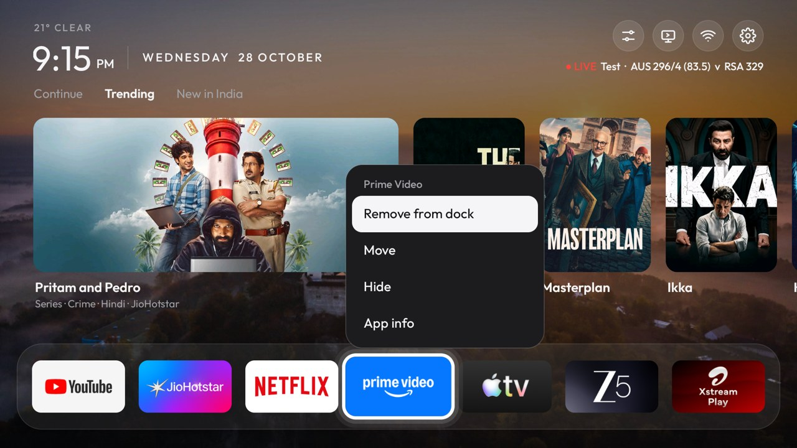
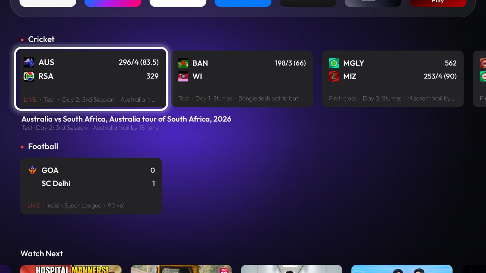
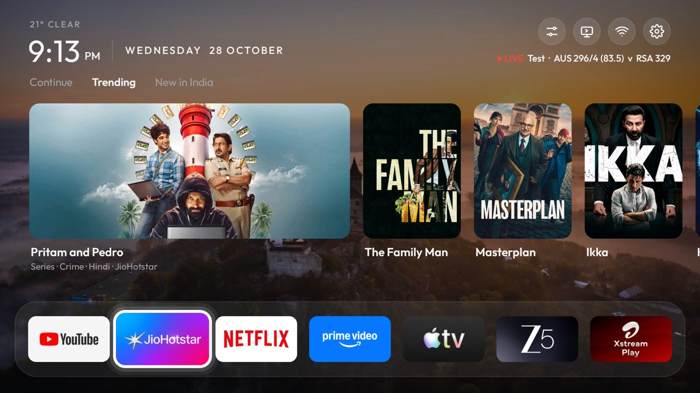
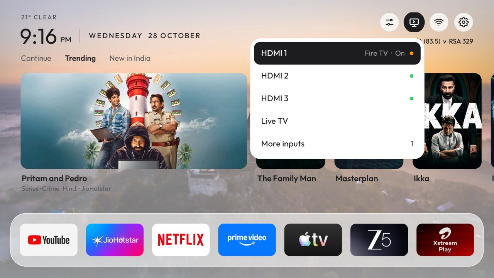

# Talkies



A small, ad-free home screen for Android TV and Google TV: one calm screen, light by day and dark at night. About
200 KB, no libraries, MIT licensed. Built in India for personal use, on a OnePlus TV (Android TV 11, Google TV
launcher); it adapts to the TV's country (picks, cricket, °C or °F) and screen, but other TVs and countries haven't
been tested.

**Version 0.4.1** (beta). What changed in each version: [CHANGELOG.md](CHANGELOG.md).

Talkies only replaces the home screen: it doesn't remove the TV maker's apps, ads services or tracking. To do that
too, use [CleanYourTV](https://github.com/Gathin23/cleanyourtv) first; Talkies works alongside it.

**Yours to change, and set for where you live.** Talkies works out your country from the TV's time zone (many TVs
stay on "English (United States)" wherever they are), and almost everything on the screen can be changed:

| | Set for your country | You can change |
|---|---|---|
| **Weather** | °C or °F; day and night follow your sunrise and sunset | The area (a town or `lat,lon`), in Talkies settings → Keys and location |
| **For You** | Trending and *New in your country* only show titles that stream on a subscription where you are | Show or hide it |
| **Dock** | — | Which seven apps, and their order: hold OK on an app to add, remove or move it |
| **Cricket** | Your team's matches first, then other internationals and your domestic competitions (IPL, Ranji Trophy… in India) | On or off |
| **Football** | Your country's leagues by default (Premier League, Champions League and ISL in India; MLS first in the US…) | Pick any leagues |
| **Channels, keys, look** | — | Which channel rows and their order, what each remote button does (tap and hold), Light, Dark or Auto, wallpaper |

Wrong country? Set it with `./set-region.sh GB`.

- Top left, the weather, then the time and date ("22° OVERCAST", "11:10 PM | WEDNESDAY 21 OCTOBER")
- **For You** below it: three tabs (Continue, Trending, New in *your country*) and a row of picks, the current pick large with
  a one-line description ("Film · Comedy · Hindi · Netflix"), the next ones small beside it. It can be hidden, and the clock then grows
- **RAM and storage** top right: two slim meters with how much of each is free, beside the round icon buttons: **Control Center**, **Inputs** (HDMI 1–3 with the plugged-in device and whether it's on
  or in standby over HDMI-CEC, under the name it's known by, e.g. "Fire TV · Standby" or "PlayStation 5 · On", with a dot
  in the brand's colour; AV, Live TV), **Wi-Fi**, **Settings**,
  and a **bell** that appears only while the Play Store has app updates waiting (OK opens them in the Play Store),
  with the cricket score under them
- A dock of seven apps in one frosted band. An app with no TV banner gets a tile made from its icon: its logo on its
  own colour, or its logo and name on white, like a TV banner
- **Channels** below the dock, like Projectivy: rows your apps publish (JioHotstar's Top Picks, Netflix, YouTube's
  Recommended, Prime Video…) and Watch Next; you choose which and their order
- **Cricket**: a live score under the icons and a Cricket row above the channels, for international matches and
  your country's domestic competitions (optional, needs a free CricketData.org key)
- **Football**: live scores from the leagues you pick (Premier League, Champions League, LaLiga, MLS, Indian Super
  League and more; your country's by default), with no key needed. Talkies settings → **Live scores** shows cricket,
  football, both or neither
- Every other app under **All apps**, after the channels
- A background that glows in the colour of the focused item's app (Netflix red, Prime Video blue…: the dock or
  All apps tile, the pick's app, or the channel row's app), or your own wallpaper; a white focus ring on the focused item. Moving
  is spring-driven like Free My TV: the focused item grows, the page and rows glide, and quick or held presses keep
  their speed instead of restarting. The background is drawn as one layer, which keeps it at 60 fps on this TV
- **Appearance:** Auto follows today's sunrise and sunset at your location (6:00–18:30 until known); Light or Dark
  can be fixed in Talkies settings

No ads and no video; the glow's colour comes from the app's banner, and the background is one small image stretched to the screen.
Network use: the picks (at most every 6 hours), the weather (at most every 30 minutes) and cricket (every 15 minutes
during live matches), and only while Talkies is the app in front and the TV's display is on: never behind another
app, under the screensaver or in standby. Coming back to the home screen fetches whatever went stale meanwhile, and so does the network coming back after a drop. The clock updates on the system's minute tick.

| | |
|---|---|
|  |  |
| *Inputs: each HDMI device by name, with its brand's colour* | *Control Center* |
|  |  |
| *Weather: the next six hours…* | *…and OK again for the next six days* |
|  |  |
| *Hold OK on an app to remove, move or hide it* | *Live cricket and football below the dock* |
|  |  |
| *Bing wallpaper (Talkies settings → Bing wallpaper)* | *Inputs in the light look* |
|  |  |
| *Light by day (Appearance: Auto follows sunrise and sunset)* | *For You hidden (Talkies settings → For You): a larger clock* |

## First-time setup

**What you need**

| | |
|---|---|
| **The TV** | Android TV or Google TV, **Android 8.0 (API 26) or newer**. The install script checks this before building. Built and tested on a OnePlus TV with Google TV (Android 11); other TVs and older Android versions should work but haven't been tried. On Android 8, Control Center has no Sleep timer or Turn off now: putting the TV in standby needs Android 9. Samsung, LG, Roku and other TVs that don't run Android can't use Talkies; CleanYourTV's [guide for those TVs](https://cleanyour.tv/not-android) turns off their tracking with the remote. |
| **A computer** | On the same Wi-Fi as the TV. macOS or Linux run the scripts as they are; on Windows use WSL, or the commands under *Install by hand*. |
| **Tools** | `adb` (Android platform tools), JDK 17, and the Android SDK command-line tools with platform 35. |

Installing the tools on macOS with [Homebrew](https://brew.sh):

```bash
brew install openjdk@17
brew install --cask android-platform-tools android-commandlinetools
sdkmanager "platforms;android-35" "build-tools;35.0.0"
```

On Linux, install JDK 17 and `adb` from your package manager and the
[command-line tools](https://developer.android.com/studio#command-line-tools-only) from Google, then run the same
`sdkmanager` line. If yours aren't in Homebrew's paths, set `JAVA_HOME` and `ANDROID_HOME`. The first build downloads
Gradle, so it takes a few minutes.

1. **On the TV**, turn on developer options (Settings → Device Preferences → About → press **Build** seven times),
   then **USB debugging** / **Network debugging** in Developer options. Note the TV's IP address
   (Settings → Network & Internet → your Wi-Fi network), something like `192.168.0.105`.

   **No Network debugging, only Wireless debugging?** Newer TVs (Android 11 and later) may only offer *Wireless
   debugging*, which needs pairing once. Open it on the TV, choose **Pair device with pairing code**, and on the
   computer run `adb pair` with the address and code it shows (the pairing port is different from the connect
   port):
   ```bash
   adb pair 192.168.1.20:37123
   ```
   Then use the address and port shown under **Wireless debugging** itself (not 5555) in the steps below.

   > **Every `192.168.1.20` in this README is an example.** Put your own TV's address in its place; `:5555`
   > stays as it is (it's the port network debugging uses).
2. **Connect once** and accept "Allow debugging?" on the TV:
   ```bash
   adb connect 192.168.1.20:5555
   ```
3. **Tell the scripts which TV** (this file stays on your computer; git ignores it):
   ```bash
   echo 192.168.1.20:5555 > .tv
   ```
   For the `adb` commands in this README, also `export TALKIES_TV=192.168.1.20:5555`.
4. **Choose your dock** in `app/src/main/res/values/dock.xml` (package names; list yours with the command under
   *Rearrange apps*). You can rearrange on the TV later.
5. **Build and install**: `./build-and-install.sh`. It makes Talkies the home screen and grants the permissions it
   can (location for the Wi-Fi name, TV listings for Watch Next).
6. **On the TV, switch on** (Settings → Device Preferences → Accessibility → **Talkies**) and allow
   **notification access** for Talkies (Settings → Apps → Special app access). The first keeps Home on Talkies
   and powers Turn off, Remote keys and the sleep warning; the second powers Continue and the update bell.
7. **Optional extras:**
   - Picks: a free [TMDB](https://www.themoviedb.org/settings/api) key
   - Cricket: a free [CricketData.org](https://cricketdata.org) key
   - Weather: your area (`"Camden, London"`) or `"lat,lon"`

   Enter all three on the TV in Talkies settings → **Keys and location**: **Send from your phone** shows a QR code
   that opens a page on your phone to paste them into (each key is checked before it's saved), or type them with the
   remote, or from the computer with `./set-tmdb-key.sh`,
   `./set-cricket-key.sh` and `./set-location.sh "your area"`.
   - Accessibility restored after a force stop: the `pm grant` under *Google Assistant and the Google TV launcher*
   - Sharp YouTube pictures: Talkies settings → **Sharp YouTube pictures** (off by default; see *Continue*)

Keys are stored on the TV and in git-ignored files next to the scripts, your location only on the TV; neither is in the app or the
repository. `./restore.sh` puts the TV back the way it was.

**Things to know before you publish a fork or build:** the release build is signed with your computer's debug key,
so a build from another computer can't update it (uninstall first). Talkies uses an accessibility service, which
is fine for sideloading but not allowed on Google Play for this purpose.

## Install by hand

What `build-and-install.sh` does, one command at a time (also the way on Windows without WSL: use `gradlew.bat`).
Replace `192.168.1.20:5555` with your TV's address.

```bash
./gradlew assembleRelease                                   # → app/build/outputs/apk/release/app-release.apk
adb connect 192.168.1.20:5555
adb -s 192.168.1.20:5555 install -r app/build/outputs/apk/release/app-release.apk
adb -s 192.168.1.20:5555 shell cmd package set-home-activity --user 0 com.techpp.glass/.HomeActivity
adb -s 192.168.1.20:5555 shell pm grant com.techpp.glass android.permission.ACCESS_FINE_LOCATION   # Wi-Fi name
adb -s 192.168.1.20:5555 shell pm grant com.techpp.glass android.permission.READ_TV_LISTINGS       # Watch Next
```

Then on the TV switch on **Accessibility → Talkies** and **notification access** (step 6 above). Optional keys are
plain text files the app reads from its folder on the TV:

```bash
adb -s 192.168.1.20:5555 shell mkdir -p /sdcard/Android/data/com.techpp.glass/files
adb -s 192.168.1.20:5555 push tmdb_key.txt /sdcard/Android/data/com.techpp.glass/files/
adb -s 192.168.1.20:5555 push cricket_key.txt /sdcard/Android/data/com.techpp.glass/files/
```

**Google TV only:** its setup wizard (`com.google.android.tungsten.setupwraith`) also answers Home. The script
disables it with `pm disable-user --user 0`, **except** when your Wi-Fi network was saved during the TV's first
setup: that network belongs to the wizard and disabling it deletes the network. Check first:

```bash
adb -s 192.168.1.20:5555 shell dumpsys wifi | grep -o 'cname=[^ ]*'
```

If it lists `setupwraith`, forget and re-join the network in Settings → Network first (on Ethernet it doesn't matter).

There are no prebuilt APKs: the build takes about a minute and you know what's going on your TV. A build is signed
with your own computer's debug key, so a build from another computer can't install over it (uninstall first).

## Remote controls

| Where you are | Up | Down | Left / Right | OK | Back |
|---|---|---|---|---|---|
| Icon buttons | — | Tabs (or the dock when there are no picks) | Next button; stops at the ends | Open | Dock |
| Tabs | Icon buttons | Picks | Switch tab; stops at the ends | Picks | Dock |
| Picks | Tabs | Dock | Next pick (it grows, the row slides); stops at the ends | Open it | Dock |
| Dock | Picks (or the icon buttons) | First channel (or All apps) | Next app; stops at the ends | Launch (hold: dock, Move, Hide, Uninstall, App info) | — |
| Channels | Row above (the dock from the first) | Row below (All apps after the last) | Next card; the row slides | Open that title | Dock |
| All apps | One row up (the last channel from the top row) | One row down | Next app in the row | Launch (hold: dock, Move, Hide, Uninstall, App info) | Dock |
| Inputs / Control Center | Previous | Next | Close | Choose | Close |

**Home** always brings you back to the dock, at the top, on the Trending tab.

## Trending and New in …

The picks row sits above the dock. Two of its tabs come from TMDB, for the TV's country:

- **Trending**: what's popular right now on your apps here: titles from your country mixed with English ones, two of
  yours for every English one (in India, Hindi, Tamil, Telugu and other Indian titles with English ones; TMDB's own
  trending list is worldwide and almost all English). In English-speaking countries (US, UK, Canada, Australia,
  New Zealand, Ireland) it's simply what's popular there. Titles already in the "New in" tab are left out.
- **New in *your country*** ("New in India", "New in the US"): your country's films from the last 6 months and series
  with new episodes in the last 60 days.

Both only include titles that stream (included in your subscription, not rent or buy) in your country on an app
installed on this TV: Netflix, Prime Video, Disney+ / JioHotstar, Apple TV, Max, Hulu, Peacock, Paramount+, ZEE5,
SonyLIV, MX Player, Xstream Play, FanCode, Crunchyroll or MUBI.

**Which country:** the TV's time zone (where it actually is; many TVs stay on "English (United States)" wherever
they are), then its language setting. If that's wrong for you, set it: `./set-region.sh GB` (`--remove` to go back).
It also picks the cricket and °C/°F behaviour below.
Each tab keeps up to 24 and shows 12 of them, moving on by 4 each hour, so the large card and the row change through
the day and the same set comes back only after 6 hours. The lists refresh at most every 6 hours (TMDB's popularity
rankings change about daily, so refreshing more often would mostly fetch the same lists); a refresh takes a few seconds. Under the large card: film or series, genre, language (when not English) and the app.
Pictures: the large card uses TMDB's 1280-pixel backdrop and the small cards the title's poster, so neither is
stretched; only the large card's full-size picture is kept in memory.
**OK** on a pick opens that app.
TMDB doesn't know each title's ID inside Netflix, Hotstar and the rest, so the app opens to its home screen, not the title.

The picks come from [TMDB](https://www.themoviedb.org), which needs a free key of your own:

1. Create an account at [themoviedb.org](https://www.themoviedb.org/signup) and open
   [Settings → API](https://www.themoviedb.org/settings/api). Request a developer key (personal use).
2. Run the key script and paste the **API Read Access Token** (or the shorter **API Key**) when it asks.
   Nothing is shown while you paste.

   ```bash
   ./set-tmdb-key.sh
   ```

3. Press Home on the remote. The first picks take about a minute.

The key is stored in `tmdb_key.txt` here (readable only by you) and in the launcher's folder on the TV; it is never
built into the app, and `build-and-install.sh` puts it back after a reinstall. To turn the row off:
`./set-tmdb-key.sh --remove`. If the row doesn't appear, check the log:

```bash
adb -s "$TALKIES_TV" logcat -d -s GlassTrending
```

## Continue

The first tab shows at least ten recent titles: first the newest from each app you've watched (so one app can't take
over the front of the row), then the next newest. YouTube gets at most two cards. Cards from Watch Next show how far in you are when the app shares it (Prime Video and Xstream Play do).
It combines two sources:

- **Android TV's Watch Next list.** Netflix, Prime Video, JioHotstar, Apple TV and Xstream Play publish what you're
  in the middle of, with the show, season, episode and artwork. **OK** opens that exact title or episode
  (tested with Netflix: it opened the episode and played it). Only "continue" and "next episode" entries are used;
  "new season" and watchlist entries are promotions and are left out.
- **What apps report while playing** (media sessions), for apps that don't use Watch Next, such as YouTube and ZEE5,
  and for apps whose Watch Next is behind: JioHotstar doesn't always update it, so a title it played more recently
  than its newest Watch Next entry shows too. Watch Next is reread whenever an app changes it (Netflix updates it a
  few seconds after you leave), and the Watch Next channel row shows this same list.
  Pictures: YouTube shares only a 640-pixel picture while playing (no video ID). With Talkies settings → **Sharp
  YouTube pictures** on (it's off by default), Talkies looks the video up on YouTube by title and channel,
  confirms it through YouTube's public oEmbed endpoint, and swaps in the 1280 × 720 thumbnail (only the title and
  channel are sent; once per video, while the home screen is in front). This reads YouTube's search page, which
  YouTube's terms don't really invite; that's why it's opt-in. Apps that share no
  picture (JioHotstar) get a card in the app's colour with its logo, sharp, in the middle.
  A title is added after 20 seconds of playback, so ads and previews are skipped. **OK** opens the app.

An app that publishes to Watch Next is taken from there only, so it doesn't appear twice. Music apps (Spotify,
YouTube Music) are left out.

| App | Source | What you see |
|---|---|---|
| Netflix, Prime Video, Apple TV, Xstream Play | Watch Next | Show, season and episode with artwork; opens that episode |
| JioHotstar | Watch Next | Same as above (its playback reports only had the episode name) |
| YouTube | While playing | Video title and thumbnail; opens YouTube |
| ZEE5 | While playing | Title (e.g. "Max") on the ZEE5 banner; opens ZEE5 |

**Permissions:** Watch Next needs the *TV listings* permission, which `build-and-install.sh` grants.
For the "while playing" titles, Android only shares what's playing with an app that has *notification access*.
On the TV: **Settings → Apps → Special app access → Notification access → Talkies → Allow.**
Talkies reads no notifications; it uses the access only to see apps' media sessions (what's playing), and
keeps the list on the TV (`/sdcard/Android/data/com.techpp.glass/files/recent/`). To stop it, switch the same toggle off;
to clear the list:

```bash
adb -s "$TALKIES_TV" shell rm -rf /sdcard/Android/data/com.techpp.glass/files/recent
```

## Channels

Rows below the dock, read from the channels your apps publish to Android TV (the same ones Projectivy shows), plus
**Watch Next**. Each row shows up to 15 cards, the one you watched last first when the app says when (Nuvio does;
others keep their own order); the focused card's title and description appear under it, and **OK**
opens that title in its app (for example a JioHotstar card opens that film's page). Rows refresh whenever the home
screen opens.

**Choose channels:** Talkies settings → **Channels** lists every channel your apps publish.

- **OK** shows or hides a channel.
- **Hold OK**, then **Up/Down**, moves it; **OK** places it, **Back** cancels. The first shown channel is the top row.

To start with, Watch Next and each app's own home-screen row are shown (the rows an app asks Android TV to show,
or, where the TV doesn't say, as on Google TV, each app's first row); the rest start hidden, and so do channels an
app adds later. A TV that had Talkies before this keeps the rows it had.
Artwork is cached on the TV in `files/channels/`.

## Cricket

While a match is live or on today, the line under the weather shows the most relevant one, for example
"● LIVE  ODI · AFG v BAN 116/4 (29.5)" (your country's team first, then other internationals, then domestic), and a
**Cricket** row appears at the top of the channel rows: each card has both teams' flags and scores, the match type and
status ("LIVE · Test · Day 4: 3rd Session…"); the caption under it names the series.

At stumps, lunch, tea or a rain delay nobody is playing, so a match isn't shown as live: the line reads
"Test · AUS v RSA 329 · Day 1: Stumps", it's still checked every 15 minutes for play to resume, and a football match
being played comes first (the Football row then sits above Cricket).

- **Match type:** Test, ODI or T20I for internationals; First-class, One-day or T20 for domestic matches.
- **Tests show every innings:** "425/9d & 84/1 (25)" and "99": all out shows the runs, a declaration adds "d", the
  innings in progress shows wickets and overs.

- **Which matches:** internationals between national teams (men's and women's; "A" sides and franchise leagues
  abroad are left out) and your country's domestic competitions: in India the IPL, WPL, Ranji Trophy, Syed Mushtaq
  Ali, Vijay Hazare, Duleep, Irani, Deodhar and Cooch Behar; in Australia the Big Bash, Sheffield Shield and Marsh
  Cup; in the UK the County Championship, The Hundred and the T20 Blast; and the main leagues of New Zealand, South
  Africa, Pakistan, Sri Lanka, Bangladesh, the Caribbean, the UAE and the US.
- **OK** opens the stream: if one of your apps has a card for the match in its TV channel (one naming both teams),
  that card's link opens the match itself. Otherwise, outside India, the card says no app has it (rights vary too much
  by country to guess). In India the app with the rights there opens: JioHotstar for BCCI matches (home internationals, domestic, IPL) and ICC events, FanCode for the
  Lanka Premier League, SonyLIV for the Asia Cup. For India's away tours and other countries' series, rights vary; the
  fallback is JioHotstar, which may not have them. When it's JioHotstar, its search opens with both teams typed in
  ("Afghanistan vs Bangladesh"), so the match is one click away if JioHotstar streams it. JioHotstar's search links
  ignore the text, so the Talkies accessibility service types it (see Control Center below); with the service off,
  the search page opens empty. JioHotstar's results list highlights and replays too, and a series it doesn't stream
  shows only older clips.
- **Data:** [CricketData.org](https://cricketdata.org)'s `cricScore` (all current matches in one request). The free
  key allows 100 requests a day, so it refreshes every 15 minutes while a match is live and hourly otherwise, only
  while Talkies is in front with the TV's display on, and stops for the day at 92. The quick list only has each team's latest innings,
  so a live Test's full innings come from one extra request (`match_info`): every 15 minutes for the Test shown first,
  every 45 for up to two more (45 for all once 70 requests are used). The feed sometimes credits an innings to the
  wrong team (a follow-on came through as the other side's); the launcher checks the latest innings against the
  status ("Australia trail by 242 runs") and moves it to the side the numbers fit. Scores can lag the TV broadcast by a few minutes.

Set your key once (a free account at cricketdata.org gives one), the same way as the TMDB key:

```bash
./set-cricket-key.sh
```

`./set-cricket-key.sh --remove` turns cricket off. Both scripts press Home on the TV when done. The log shows what it
found and where each Watch button points: `adb -s "$TALKIES_TV" logcat -d -s GlassCricket`.

## Football

Football works like cricket, with no key: the line under the weather shows the most relevant match
("● LIVE  67'  ·  ARS 2–1 CHE", a live cricket match comes first), and a **Football** row with both clubs' badges,
the score and the minute ("LIVE · Premier League · 67'"), kick-off time ("starts Wed 7:30 pm") or result.

- **Which matches:** live now, starting within a day, or finished in the last 12 hours, from your leagues.
- **Your leagues:** Talkies settings → **Football leagues**. Each country starts with its own (India: Premier League,
  Champions League and Indian Super League; the UK: Premier League, Champions League and the Scottish Premiership;
  the US: MLS, Premier League and Champions League…), plus the World Cup and the Euros when they're on. Press OK to
  turn one on or off; **Back to the defaults** undoes your changes.
- **Updates:** every 15 minutes, and every minute for a league with a match on, only while Talkies is in front.
- **Data:** ESPN's public scoreboard. It's free and needs no key, but it isn't an official API: ESPN can change it
  without notice, and then the Football row just stays away until Talkies is updated.
- **Watching:** not yet. Which app shows which league differs by country, so OK on a match card says so for now.

## Control Center

Go up to the icon buttons and choose the first one (sliders). It has what you reach for while watching; everything
you set once is in **Talkies settings**, at the top.

| Row | What OK does |
|---|---|
| Fix Home and Turn off | Only when Talkies' accessibility service has stopped (see below): opens Accessibility, where you switch Talkies off and on |
| Talkies settings | Opens Talkies settings (below) |
| Now playing | Only while an app plays (or has paused) something: the song or show, its artwork, artist and app, then **Pause** / **Play**, **Next**, **Previous** (when the app allows skipping) and **Open** the app. It follows the player as tracks change |
| Weather | The current weather on the right; OK shows the next six hours, and OK again the next six days (high / low and conditions) |
| Sleep timer | Cycles Off → 30 → 60 → 90 min; the time left shows on the right. A minute before, a card counts down over whatever is playing: **OK** gives 15 more minutes |
| Turn off now | Puts the TV in standby |
| Free up memory | Stops background apps (never system apps) and shows how much RAM came back |
| Storage | Shows the free space ("12.4 GB free of 32 GB"); OK opens the TV's storage settings |
| Animations | Cycles the speed of every animation on the TV: 1× → 0.5× → Off. Faster makes menus and app switches feel snappier; Off also stills Talkies' own motion. Needs the `WRITE_SECURE_SETTINGS` grant (see *Google Assistant*) |
| Network | Shows the Wi-Fi name (or Ethernet); OK opens Wi-Fi settings |
| Speed test | A few seconds' download from Cloudflare's speed test; shows e.g. "206 Mbps" |
| Bluetooth | Shows the connected speaker or headphones. OK lists your paired ones: OK on one connects or disconnects it; **Pair a new device** opens the TV's Bluetooth settings. Bluetooth can't be turned off here, since many remotes use it |
| Sound output | Shows TV speakers or Soundbar (HDMI ARC) and opens the TV's Sound settings |
| Screensaver | Starts the TV's screensaver right away |
| Restart… | Opens the TV's own power menu, which asks before restarting. On some TVs (OnePlus) that menu puts the TV to sleep after 10 seconds if you choose nothing; Back closes it |

## Talkies settings

Control Center → **Talkies settings**, or **hold OK on the ⚙ icon** (a press still opens the TV's own settings).

| Row | What OK does |
|---|---|
| Keys and location | Your TMDB key (picks), CricketData key (scores) and weather area. **Send from your phone** shows a QR code: scan it with a phone on the same Wi-Fi and paste them into the page it opens (it works once, for 5 minutes, only on your home network, and the keys stay on the TV). Or type or paste each one; keys are tried with the service first and only saved if it accepts them. **Remove** clears one |
| Appearance | Cycles Auto (light by day, dark at night) → Light → Dark. With a wallpaper, Auto picks the look that suits the photo instead, and every look adds just enough veil behind the text to keep it readable |
| For You | Shown or Hidden. Hidden removes the tabs and picks (the weather, time and date stay, larger), Up from the dock goes to the icons, and TMDB picks aren't fetched |
| RAM and storage | Shown (default) or Hidden: the two meters beside the icon buttons, with free RAM and free storage, updated every minute |
| Live scores | Cricket and football (default), Cricket, Football or Off: what the score line and the score rows show |
| Football leagues | The leagues the Football row follows; see *Football* |
| Channels | Choose which app channels show below the dock, and their order |
| Hidden apps | Shown once you've hidden an app: the apps you hid; OK shows one again |
| Remote keys | Give a remote button another job: open an app, Inputs, Talkies, or nothing. **Add a key**, press the button, choose. Once it has a job, **When held** gives it a second one for holding it (over half a second). Navigation, OK, Back, Home, volume and power can't be changed |
| Network debugging | "On · port 5555" while computers on your network can control the TV over ADB (how Talkies was installed). **Turn off** (needs the permission below) or open Developer options; turning it on again is done in Developer options |
| Talkies at power-on | **After a restart** (default), or **Every time**: also when the TV wakes from standby into the last HDMI input or app. Pressing a button as it wakes keeps what's on screen |
| Empty inputs | **Shown** (default), or **Under More inputs**: Inputs lists only ports with something plugged in, and a More inputs row brings back the rest |
| Bing wallpaper | Off by default. On: Bing's picture of the day as the wallpaper, checked every few hours while Talkies is in front (Talkies settings → About credits the photo). Your own `wallpaper.jpg` wins over it |
| Apps open from their tile | On by default: an app's window grows out of the tile or card you chose. It's Android's normal opening animation, started from the tile, so it costs nothing extra |
| Home app | Shows the current home screen and opens Android's *Default home app* chooser (on Google TV the choice doesn't stick; see *Use another home screen*) |
| Sharp YouTube pictures | Off by default. On: YouTube cards in Continue get YouTube's 1280-pixel thumbnails, looked up by title and channel |
| About | Credits for the data and code Talkies uses |

**One-time setup for Turn off now, the sleep timer and cricket search:** this TV has no "device admin" support, so the
launcher turns the TV off through a small accessibility service. The same service types a match into JioHotstar's
search when a Cricket card has no direct link. It only sees JioHotstar's screen, only acts for 30 seconds after you
pick a card, and only looks for the search box. Switch it on once at **Settings → Device Preferences → Accessibility →
Talkies**. Until then, choosing Turn off or the sleep timer takes you to that screen.

**If the service stops:** Android can stop the service (a crash, or memory running low) while its switch still looks
on, and then Home, Turn off and Remote keys quietly stop working. Talkies checks a few seconds after it opens: with
the `WRITE_SECURE_SETTINGS` grant (see *Google Assistant*) it switches the service off and on itself; without it, a
note at the top of the home screen says so, and Control Center gets a **Fix Home and Turn off** row.

## Use another home screen

- **Google TV:** Google TV keeps its own launcher as the home app whatever you choose in *Default home app* (checked
  on this TV), so third-party launchers, Talkies included, take the Home button with an accessibility service. To use
  another one, turn off **Settings → Device Preferences → Accessibility → Talkies** and turn on that launcher's own
  Home option. Turn Talkies' back on to return.
- **Android TV:** Talkies settings → **Home app** opens Android's chooser; pick another launcher and Talkies' service
  leaves the Home button to it. Pick Talkies there to come back.
- **From a computer:**

  ```bash
  ./switch-home.sh list                       # the home screens on the TV
  ./switch-home.sh talkies                    # Talkies
  ./switch-home.sh stock                      # the TV's own home screen
  ./switch-home.sh com.spocky.projengmenu     # any launcher you installed, by package name
  ```

  It says so when the TV ignores the choice (Google TV).

To just peek at another launcher, open its tile under All apps; Home still brings you back to Talkies.

## Scripts

```bash
./build-and-install.sh                 # optimised build (about 200 KB, no libraries), install, set as home
./restore.sh                           # the TV's own home screen back, Talkies removed
./restore.sh --keep-talkies            # the TV's own home screen back, Talkies kept
./set-region.sh GB                     # use another country for picks, cricket and °C/°F (--remove: the TV's own)
./backup-settings.sh                   # copy Talkies' settings from the TV to talkies-backup.json here
./restore-settings.sh                  # put them back (after reinstalling, or on another TV)
```

**Back up your settings:** `./backup-settings.sh` saves Talkies settings, the dock and app order, hidden apps, remote
keys, channels, football leagues, the keys and the weather area (and your `wallpaper.jpg`) to `talkies-backup.json`
next to the scripts. After an uninstall, or on another TV, install Talkies, open it once, and run
`./restore-settings.sh`: it starts again with everything as it was. The picks, scores and weather aren't in it; they
fetch again. The file holds your keys, so git ignores it; keep it private.

**Screens:** the layout is drawn for a 960 × 540 dp screen and scales itself to any TV's width, so it fills the
screen the same way whatever density the TV reports.

Every script takes the TV's address as an optional last argument; otherwise it uses `TALKIES_TV` or the `.tv` file (see First-time setup).
Building needs the tools under *First-time setup*; the build script uses Homebrew's paths unless `JAVA_HOME` /
`ANDROID_HOME` say otherwise.

## Weather

The weather shows at the top left, for example "27° SHOWERS", in °C, or °F where that's the custom (the US and a
few others; see *Which country* above).
The weather part combines two sources:

- **Temperature** is measured at the **nearest airport weather station**. Airports publish observations (METAR) every
  30–60 minutes; Talkies reads them from the US National Weather Service's free
  [aviationweather.gov](https://aviationweather.gov) service, picking the closest report from the last two hours
  within about 200 km (in a big city, usually the city's airport). Closer stations may exist (national weather
  services, personal weather stations), but few publish freely for apps.
- **Rain and cloud** come from [Open-Meteo](https://open-meteo.com)'s model for your exact coordinates, because an
  airport 15–20 km away can be dry while it rains at home.

Without a recent airport report, the temperature also comes from Open-Meteo. It refreshes at most every
30 minutes, and only while the home screen is showing.

Set your area once:

```bash
./set-location.sh "12.97,77.64"     # your latitude,longitude
```

Coordinates are best. A place name also works (`./set-location.sh "Indiranagar, Bengaluru"`), looked up with
Open-Meteo's place search; if it doesn't know the exact locality, it uses the city centre. Running the script again refreshes the weather straight away;
`./set-location.sh --remove` leaves just the time and date. Today's sunrise and sunset come from the same Open-Meteo
request and set when the Auto appearance switches between light and dark.

## Hold OK: app and Continue menus

**Hold OK** (about half a second) on:

- **An app** in the dock or All apps:
  - **Add to dock** (from All apps): it takes the dock's last spot, and the app that was there moves to the front of
    All apps. **Remove from dock** does the opposite: the first app in All apps takes its spot.
  - **Move** (below), to place it exactly.
  - **Hide**: it leaves the dock and All apps but stays installed (voice search and Settings still open it).
    Talkies settings → **Hidden apps** lists them; OK shows one again, at the end of All apps.
  - **Uninstall** opens Android's own "Uninstall this app?" dialog, and only shows for apps you installed (not system
    apps or Talkies). **App info** opens the app's page in Settings.
- **A Continue card** (the Continue tab or the Watch Next row): **Remove from Continue**, or **Open** the app itself
  rather than the episode. A removed title stays out until the app reports a new episode of it.

**Back** closes a menu without doing anything.

## Rearrange apps

1. **Hold OK** on any app in the dock or All apps and choose **Move**. It lifts out, with a thicker ring,
   and a hint appears at the top.
2. **Use the arrows** to move it. Within a row it trades places with its neighbour; in the grid, Up and Down move it a
   row and the other apps shift along. Moving between the dock and All apps swaps it with the app there, so the dock
   always keeps seven.
3. **Press OK** to place it, or **Back** to cancel and put everything back as it was.

The order is saved on the TV and survives restarts and reinstalls. Apps you install later are added to the end of the
grid. Picks (Continue, Trending, New in …) can't be moved.

The starting dock, before you've moved anything, comes from `app/src/main/res/values/dock.xml`. Package names are
listed with:

```bash
adb -s "$TALKIES_TV" shell cmd package query-activities --brief -a android.intent.action.MAIN -c android.intent.category.LEANBACK_LAUNCHER
```

## Change the wallpaper

Copy an image to the launcher's folder on the TV. It can be `wallpaper.jpg`, `wallpaper.png` or `wallpaper.webp`; 1920×1080 works best.

```bash
adb -s "$TALKIES_TV" push my-picture.jpg /sdcard/Android/data/com.techpp.glass/files/wallpaper.jpg
```

Press Home on the remote to see it. It replaces the app-colour glow. No computer? Talkies settings → **Bing
wallpaper** uses Bing's picture of the day instead (your own picture wins when both are there).
To go back to pure black, delete the file:

```bash
adb -s "$TALKIES_TV" shell rm /sdcard/Android/data/com.techpp.glass/files/wallpaper.jpg
```

## Google Assistant and the Google TV launcher

The TV's own launcher stays **enabled**. On Google TV (`com.google.android.apps.tv.launcherx`) the Assistant shows
many answers in it: "show me comedy shows" opens its results page, "Stranger Things" its title page. With it disabled
those queries failed with "Google Assistant is having a problem processing your request", while opening apps still
worked.

Enabled, it claims the Home button, so the **Talkies accessibility service must be on** (Settings → Device
Preferences → Accessibility → Talkies). It:

- opens Talkies when you press Home;
- opens Talkies over the TV's built-in home screen when that appears on its own (after a restart, or backing out
  of its pages), except within 8 seconds of the Assistant, so its results stay up. The built-in launchers are found
  when the service starts (Google TV's, Android TV's or the TV maker's: system apps that can be the home screen);
  launchers you installed yourself, like Projectivy, are left alone;
- sees only the windows of JioHotstar, those launchers and the Assistant, and filters only Home, OK while the sleep
  warning is up, and remote buttons you've given a job.

If the service is ever off, Home shows Google TV (with its ads) until you switch it back on. `build-and-install.sh`
warns when it's off. Android switches it off if Talkies is force-stopped (it counts as a crash), so don't use
"Force stop" on Talkies; the scripts here no longer do.

**Optional: put it back automatically.** Grant Talkies permission to change secure settings, once:

```bash
adb -s "$TALKIES_TV" shell pm grant com.techpp.glass android.permission.WRITE_SECURE_SETTINGS
```

Then, if a force stop switches the service off, Talkies switches it back on the next time it starts (you open it
from Google TV's apps, the TV restarts, or it's updated). It only does that if the service was on when it was killed;
if you switch it off yourself, it stays off. The same permission lets Talkies settings → Network debugging turn
debugging off, and Control Center → Animations change the TV's animation speed. It's a powerful permission (an app holding it can change system settings), so it's your call;
`adb shell pm revoke com.techpp.glass android.permission.WRITE_SECURE_SETTINGS` takes it back.

Remote buttons and Home are seen by the service only from a real remote: keys sent with `adb shell input keyevent`
skip Android's accessibility key filter, so Home sent that way opens Google TV. Known gap: choosing a film inside the Assistant's own results list doesn't open its page (the
Google app declines to start it); asking for the title by name does.

## Google TV's setup wizard

On Google TV, `build-and-install.sh` turns off Google's setup wizard (`com.google.android.tungsten.setupwraith`),
because it also answers the Home button; it's the only app Talkies' scripts turn off. To turn it back on:

```bash
adb -s "$TALKIES_TV" shell pm enable com.google.android.tungsten.setupwraith
```

If you turn the wizard or the Google TV launcher back on, Android may switch Home back to them. To make Talkies the
default again:

```bash
adb -s "$TALKIES_TV" shell cmd package set-home-activity --user 0 com.techpp.glass/.HomeActivity
```

## When something goes wrong

| What you see | Why, and the fix |
|---|---|
| `adb connect` is **refused** and the TV has no *Network debugging* | Your TV uses *Wireless debugging*: pair once with `adb pair` (see *First-time setup*, step 1), then connect to the port Wireless debugging shows. |
| `adb connect` says **No route to host** on a Mac | macOS's Local Network privacy is blocking your terminal. System Settings → Privacy & Security → Local Network → allow your terminal app, then try again. |
| No **"Allow debugging?"** prompt on the TV, or `unauthorized` | `adb kill-server`, then `adb connect` again with the TV on and its home screen showing. Some TVs only show it after Network debugging is switched off and on. |
| **Home opens Google TV** (or the TV's own launcher) | The Talkies accessibility service is off: switch it on in Settings → Device Preferences → Accessibility. A force stop turns it off; the `pm grant` under *Google Assistant* makes Talkies put it back. |
| **"Google Assistant is having a problem"** | The Google TV launcher was disabled. `adb shell pm enable com.google.android.apps.tv.launcherx` |
| **Home opens a setup screen** after installing | Google's setup wizard was left on to keep your Wi-Fi network (the script says so). See *Install by hand*. |
| **No picks** under Trending | No TMDB key (`./set-tmdb-key.sh`), or the first fetch is still running: picks arrive within a minute of opening Talkies with the TV online. |
| **Continue** stays empty | Notification access isn't on, or `READ_TV_LISTINGS` wasn't granted (see *Install by hand*). |
| `INSTALL_FAILED_UPDATE_INCOMPATIBLE` | The installed Talkies was built on another computer. `adb uninstall com.techpp.glass`, then install again (settings and history start over). |
| The install script stops at **API 2x** | The TV runs Android 7.1 or older; Talkies needs Android 8.0. |

## When you're done: close network debugging

Network debugging lets any device on your Wi-Fi that you've allowed control the TV, and on some TVs any device at
all. Talkies doesn't need it once it's installed: only to update it or change keys from a computer.

1. On the TV: Developer options → **USB debugging** and **Network debugging** off, and **Revoke USB debugging
   authorisations**. Or Talkies settings → **Network debugging** in Talkies, which shows whether it's on.
2. From your computer, `nc -vz 192.168.1.20 5555` should now say **Connection refused**. ("No route to host" on a
   Mac can be Local Network privacy, not a closed port.)

Turn it back on when you want to update Talkies.

## Going back

`./restore.sh` puts the TV's own home screen back, turns Google's setup wizard back on (Google TV) and uninstalls
Talkies (`--keep-talkies` keeps it installed). By hand:

```bash
adb -s 192.168.1.20:5555 shell pm enable com.google.android.apps.tv.launcherx           # Google TV only
adb -s 192.168.1.20:5555 shell pm enable com.google.android.tungsten.setupwraith        # Google TV only
adb -s 192.168.1.20:5555 uninstall com.techpp.glass
```

Without a computer: Settings → Apps → Talkies → Uninstall, and the TV's own launcher takes Home again.

## Credits

Data (also listed in the app, Talkies settings → About):

- **Picks:** [TMDB](https://www.themoviedb.org). *This application uses TMDB and the TMDB APIs but is not endorsed,
  certified, or otherwise approved by TMDB.* You use your own free API key, under TMDB's [terms of use](https://www.themoviedb.org/api-terms-of-use).
- **Weather:** [Weather data by Open-Meteo.com](https://open-meteo.com/), under
  [CC BY 4.0](https://creativecommons.org/licenses/by/4.0/); airport temperatures from NOAA's
  [aviationweather.gov](https://aviationweather.gov).
- **Cricket:** [CricketData.org](https://cricketdata.org), with your own key.
- **Football:** ESPN's public scoreboard (not an official API; Talkies isn't affiliated with ESPN).
- **Speed test:** Cloudflare's public speed-test endpoint.

Code (details and license texts in `THIRD_PARTY_NOTICES.md`, all MIT):

- Control Center, and putting the accessibility service back after a force stop: tv-vibehack, now
  [CleanYourTV](https://github.com/Gathin23/cleanyourtv).
- The damped spring behind the motion, and the trending row's idea: [Free My TV](https://github.com/simbasjungles/free-my-tv).
- The speed test, HDMI-CEC names and the update bell's approach: [Matinee](https://github.com/Jarvis322/matinee).
- Recognising consoles and players by what they announce over HDMI-CEC: [Luma](https://github.com/0xProbabillity/luma-tv).
- Tiles for apps without a TV banner: [GlassLauncher](https://github.com/tlfares/GlassLauncher).

Ideas (no code; Talkies' own implementation):

- The hold-OK menu (Move, Uninstall, App info), removing a card from Continue, and giving remote buttons a new job:
  [Plume](https://github.com/aradhyas8/Plume_Launcher). Remote keys also follow CleanYourTV's.
- Bing wallpaper, channel cards in last-watched order and apps opening from their tile: Plume. Spotting a stopped
  accessibility service: [Matinee](https://github.com/Jarvis322/matinee).
- Bluetooth connect, Restart…, Talkies at power-on, Empty inputs and the settings fallback for TVs that hide the
  standard settings screen: [CleanYourTV](https://github.com/Gathin23/cleanyourtv)'s launcher and add-ons.
- Now playing and the weather forecast: [Luma](https://github.com/0xProbabillity/luma-tv).
- Animation speed and Storage in Control Center: [GlassLauncher](https://github.com/tlfares/GlassLauncher).

The Outfit typeface is © The Outfit Project Authors, licensed under the SIL Open Font License 1.1 (`OUTFIT-OFL.txt`).
